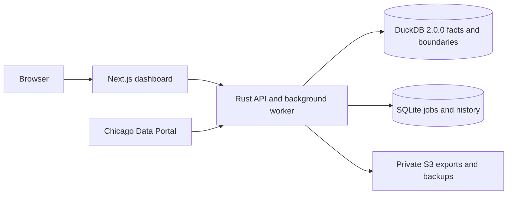

# Chicago Traffic Crash Data Pipeline

Explore Chicago traffic crashes on an interactive dashboard, compare injuries and fatalities over time, and generate location reports for uploaded administrative boundaries or a radius on the map.

The application uses **Rust**, **DuckDB 2.0.0**, **SQLite**, and **Next.js**. One backend process handles the API, portal ingestion, scheduled jobs, spatial uploads, exports, and recovery. It is designed for modest traffic and daily data updates, with bounded memory and disk use.

## What it does

- Maps crash locations and trends, with date and severity filters.
- Reports crash, injury, pedestrian, cyclist, vehicle and economic-cost metrics for a selected area.
- Accepts GeoJSON and zipped shapefiles for wards, districts, communities and other boundaries; retains configurable labels and properties.
- Downloads and validates portal data, maps CSV headers to typed API fields, and publishes updates transactionally.
- Runs durable background jobs and produces verified CSV ZIP exports through private S3-compatible storage.
- Creates paired DuckDB/SQLite backups with checksums and supports offline restore.

Map points are capped independently of report totals. Reports and exports use the full selected population.
API date filters use calendar years 0001–9999. Location reports expand at most 1,200 calendar months, including empty months; wider report ranges return a client error. Current all-history crash reports fit within that bound.

## Architecture



**Run exactly one backend process and one replica per data directory.** The DuckDB file is owned by that process; HTTP queries and database work share a serialized SQL lane. The frontend is a separate service. PostgreSQL is only needed when importing an existing deployment through the read-only migration command.

## Prerequisites

- Linux or macOS, on x86-64 or ARM64. Windows users can use Linux containers or WSL2.
- Rust **1.99.1**, selected by `rust-toolchain.toml`; install Rust with [rustup](https://rustup.rs/).
- Node.js **22 or newer** and npm; CI and the frontend image use Node 22.
- Bash, curl, tar and gzip for the native installer. A native Rust build also needs a C toolchain, OpenSSL development headers and pkg-config. On Debian/Ubuntu: `apt-get install build-essential pkg-config libssl-dev`.
- GDAL's `ogr2ogr` on `PATH` for shapefile and foreign-CRS uploads. The backend Docker image includes it.
- Approximately 8 GiB free disk for a full initial download/import and temporary files. Allow additional capacity for snapshots, exports and spill.

The installer selects the host platform, verifies the official DuckDB archive checksum and installs the matching signed spatial extension. No Python installation is required.

## Local setup

From the repository root:

```sh
bash scripts/setup-rust-duckdb.sh
cargo build --release --locked
target/release/crashes-server probe
npm --prefix frontend ci
```

The native installation defaults to `.local/rust-duckdb/`; application data defaults to `.local/data/`. All paths are relative to the checkout. To use another installation, set `DUCKDB_LIBRARY_PATH` and `DUCKDB_SPATIAL_PATH`.

Copy `.env.example` for reference and set values in your shell or environment manager. The Rust executable **does not automatically load `.env`**. Keep actual credentials outside Git. For protected local operations, set `API_KEY` before starting the backend; production requires a key of at least 32 bytes.

### Populate a new installation

Download all four public datasets, then seed the database:

```sh
target/release/crashes-server download --directory .local/sources \
  --datasets crashes,people,vehicles,fatalities
target/release/crashes-server seed --source-dir .local/sources
```

Downloads stream to disk and validate headers, row counts, source revisions and hashes. The audited [column mapping](rust/crashes-server/resources/csv_column_mapping.json) handles CSV/API naming differences. Schema drift fails for review.

Portal bulk CSVs can lag behind the API. If verification rejects a stale export, download the complete datasets into a **new directory** using the ordered API path, then seed from that directory:

```sh
target/release/crashes-server download --api --directory .local/sources-api \
  --datasets crashes,people,vehicles,fatalities
target/release/crashes-server seed --source-dir .local/sources-api
```

A new seed initializes an empty spatial catalog. Upload your own boundaries through `/admin` after starting the application. Custom boundaries and database files are not bundled with the repository. For an existing deployment, choose deliberately: [clean portal facts with preserved boundaries](docs/railway-bootstrap.md), or a [snapshot migration](docs/rust-migration.md#preserve-an-existing-deployment) that retains historical facts and operations.

### Run the application

```sh
# Terminal 1: backend, loopback port 8003
cargo run --release --locked -- serve

# Terminal 2: frontend, loopback API proxy and port 3001
npm --prefix frontend run dev
```

Open:

- [Dashboard](http://127.0.0.1:3001/dashboard)
- [Location reports](http://127.0.0.1:3001/dashboard/location-report)
- [Administration](http://127.0.0.1:3001/admin)

The default basemap uses CARTO Positron without an API key. Set `NEXT_PUBLIC_BASEMAP_URL` at frontend build time to use another MapLibre style. Internet access to the style, tiles and glyphs is required.

Automatic scheduling is off locally. Start it through the authenticated admin controls or set `DAILY_SYNC=true` after reviewing job schedules. A profiling-only seed needs `seed --profiling` and an explicit development `serve --allow-profiling-data`; that waiver is restricted to loopback and is refused in production.

### Docker Compose

After populating `.local/data/` and stopping listeners on ports 8003 and 3001:

```sh
docker compose -f docker/docker-compose.rust.yml up --build
```

Compose mounts the same data directory and runs the backend at 512 MiB and the frontend at 256 MiB, both without swap. Set `CRASHES_DATA_DIR` to an absolute host path to mount another populated directory. Set `API_KEY` in the invoking environment for protected operations. Compose is a local development setup; production configuration is described below.

## Configuration

| Setting | Default or purpose |
| --- | --- |
| `DATA_DIR` | `.local/data` locally; `/data` in the backend image |
| `DUCKDB_LIBRARY_PATH`, `DUCKDB_SPATIAL_PATH` | Override the native library and extension paths |
| `APP_ENV` | `development`; use `production` for a public deployment |
| `BIND_ADDRESS`, `PORT` | `127.0.0.1:8003` locally; image listens on `0.0.0.0:8000` |
| `API_KEY` | Secret for administrative operations and exports; production requires at least 32 bytes |
| `CRASHES_ADMIN_URL` | Optional base URL for the live operations CLI; defaults to `http://127.0.0.1:8003` |
| `DUCKDB_MEMORY_LIMIT` | CLI `256MB`; image `192MB`. This is a DuckDB buffer budget, not a total RSS limit |
| `DUCKDB_THREADS` | `2` SQL threads |
| `DUCKDB_QUERY_TIMEOUT_SECONDS` | `120`, bounded to 1–900 seconds |
| `PUBLIC_CACHE_BYTES` | `16777216`; set `0` for uncached measurements |
| `DAILY_SYNC` | CLI `false`; image `true`. Review imported schedules before enabling |
| `INGESTION_MAX_CHANGED_ROWS` | `25000`, the publication change guard |
| `CRASHES_INGESTION_MAX_BYTES` | `8589934592`, source staging disk budget |
| `EXPORT_ENDPOINT`, `EXPORT_BUCKET`, `EXPORT_ACCESS_KEY_ID`, `EXPORT_SECRET_ACCESS_KEY` | Private S3-compatible exports and backup storage; required in production |
| `EXPORT_REGION` | `auto` |
| `BACKEND_URL` | Frontend server and rewrite destination; local default `http://127.0.0.1:8003` |
| `NEXT_PUBLIC_API_URL` | Browser API prefix, default `/api` |
| `NEXT_PUBLIC_BASEMAP_URL` | Optional public MapLibre style URL |

`BACKEND_URL` is needed at **frontend build time and runtime** because Next.js compiles rewrites. Rebuild after changing it. Never use a `NEXT_PUBLIC_*` variable for a secret.

## API and administration

Public routes include `/health`, `/ready`, `/version`, dashboard queries and `/places/*`. The embedded admin uses `/admin/api/*`, which works directly and through the frontend proxy. Administrative operations use `X-API-Key`; the admin page prompts for the key when configured. Exports use the durable `/exports` workflow and signed download URLs.

```sh
curl --fail http://127.0.0.1:8003/health
curl --fail http://127.0.0.1:8003/dashboard/stats
```

[API contracts and compatibility](docs/research/rust-api-compatibility-2026-10-21.md) describes the preserved routes, sync guards and explicitly retired diagnostics. The server does not expose an autogenerated OpenAPI or documentation site.

### Live operations CLI

Use `admin` to monitor or manage the **running backend**. It sends authenticated HTTP requests using `API_KEY` from the environment and never opens DuckDB/SQLite files or takes the data-directory owner lock. Existing `inspect`, seed, migration, offline `backup` and restore commands operate on local files; use them with the owner stopped.

```sh
target/release/crashes-server admin status
target/release/crashes-server admin schedules
target/release/crashes-server admin queue
target/release/crashes-server admin scheduler status
target/release/crashes-server admin --timeout-seconds 900 backup
```

`status` returns one JSON report containing health, readiness, runtime settings, source freshness, scheduler state, administrative job totals, **native schedules** and the **durable worker queue/history**. It continues collecting checks after a failure and exits nonzero if any request fails. `ok=true` means all status endpoints responded successfully; inspect individual job states and publication receipts to assess ETL success. A stopped scheduler or failed historical job can still have a successful status response.

Fresh installations use native schedules with string IDs. These commands retain their request, interval, timeout and retry settings:

```sh
target/release/crashes-server admin schedule-disable daily-source-refresh
target/release/crashes-server admin schedule-enable daily-source-refresh
target/release/crashes-server admin scheduler start
target/release/crashes-server admin schedule-run daily-source-refresh
target/release/crashes-server admin queue
```

`schedule-run` makes an enabled, unheld schedule due on the next scheduler tick and requires the scheduler to be running. It rebases the next interval from the requested time. Its response confirms that the schedule is due; verify the actual queued/running/completed execution and publication receipt with `queue`. Disabled flags, source holds and publication guards still apply. `scheduler stop` persists a pause on future automatic dispatch; existing queued and running work continues.

Default scheduling installs a daily 30-day API window for crashes, people and vehicles, plus weekly fatality incremental updates. The daily window does not capture corrections to older crash dates. Configure explicit staggered weekly full refreshes for each core source when historical corrections must be reconciled; `mode=full` with `source_mode=api` uses complete ordered API downloads instead of potentially lagging bulk CSVs (the full-refresh default remains `source_mode=bulk`). Review each source's publication receipt in `queue`. Full refreshes retain the finite `INGESTION_MAX_CHANGED_ROWS` guard, default 25,000; a failure requires investigation rather than an automatic guard bypass. These additional full-refresh schedules are configured explicitly and are not installed as defaults.

Migrated administrative schedules use numeric IDs: `admin jobs` lists them; `admin executions --job 42 --limit 20` shows their history; `admin run 42`, `admin enable 42` and `admin disable 42` manage them. `admin executions --limit 50` shows recent administrative history. An empty administrative jobs list can coexist with active native schedules. `queue` includes up to 100 durable worker records, including native ingestion and exports.

For another backend, pass `--url https://backend.example.com` or set `CRASHES_ADMIN_URL`. The frontend proxy also works with `--url https://frontend.example.com/admin/api`. Use HTTPS across public networks. Keep the secret in `API_KEY`; URLs cannot include credentials. Each request defaults to a 180-second deadline, adjustable with `--timeout-seconds 1..900`; responses are bounded to 8 MiB. HTTP failures, redirects, timeouts and invalid JSON exit nonzero. Mutations are not automatically retried. A client timeout can leave server work running; check its result before retrying. `admin backup` creates and verifies a paired backup through the running owner, including configured offsite publication, and returns its receipt.

On Railway, open a shell in the backend service, then use its existing environment and loopback API:

```sh
railway ssh --project PROJECT_ID --environment ENVIRONMENT_ID --service BACKEND_SERVICE_ID
# In the remote shell:
crashes-server admin --url "http://127.0.0.1:${PORT:-8000}" status
crashes-server admin --url "http://127.0.0.1:${PORT:-8000}" schedules
```

Use `crashes-server admin --help` for the complete command list. Running `admin` beside the owner is safe; starting another `serve` process against its volume is not supported.

## Validation

```sh
cargo fmt --all -- --check
cargo clippy --all-targets --all-features --locked -- -D warnings
cargo test --all-targets --locked
node --test rust/crashes-server/tests/admin-ui.test.cjs frontend/tests/export-api.test.cjs
npm --prefix frontend run typecheck
npm --prefix frontend run build
```

Native tests use real temporary DuckDB databases and fail if the pinned library is missing. They load the installed spatial extension explicitly rather than relying on a user's extension cache. CI runs native tests on Linux and macOS. An optional [local S3 integration fixture](scripts/test-s3.sh) exercises authenticated delivery against a disposable MinIO container:

```sh
bash scripts/test-s3.sh
```

See [measured results and their limits](docs/research/rust-migration-results-2026-10-21.md). The tested low-traffic configuration uses a 192 MB DuckDB buffer, a 16 MiB response cache and a 512 MiB backend container. Heavy uncached reports still scan substantial data, and cgroup reclaim pressure matters. Local tests do not prove a Railway cost reduction or a production latency guarantee.

## Deploying on Railway

For a new Railway service, set the Dockerfile to `docker/Dockerfile.rust`, the start command to `/usr/local/bin/crashes-entrypoint serve`, one replica and the healthcheck to `/ready` in service settings or Railway IaC. Railway has deprecated TOML configuration for new services; the checked-in TOML files remain references for existing deployments. Mount a persistent volume at `/data`, populate it before serving, and configure production authentication and private object storage. The image initializes mounted-volume permissions, drops privileges and binds `::` for Railway's private IPv6 network and dual-stack hosts.

Deploy `frontend/` as a separate Next.js service and set its private `BACKEND_URL` for both build and runtime. No PostgreSQL server, separate ingestion/export workers, Redis, or tile server is required for normal operation.

For a clean migration, follow the [private bootstrap guide](docs/railway-bootstrap.md): download complete fresh portal CSVs, capture and restore only the existing uploaded boundaries, verify private backups and rehearse recovery before changing traffic. The temporary bootstrap process starts no public server or scheduler. The [migration and operations guide](docs/rust-migration.md) also supports preserving an entire historical PostgreSQL installation when that is required. Keep the previous deployment available for rollback until the replacement is validated.

For production with periodic full-source reconciliation, use a **2 GB backend memory ceiling**, `DUCKDB_MEMORY_LIMIT=512MB`, `DUCKDB_THREADS=1` and one replica. The smaller 192 MB image default supports the measured low-traffic query/daily-window workload, but a complete 2.25-million-row vehicle replay exhausted that buffer and rolled back. Stagger full replays by source and retain enough volume capacity for staging, spill and paired backups. A **512 MiB frontend ceiling** leaves room for cold starts. These ceilings are protective limits: [Railway bills actual resource consumption](https://docs.railway.com/guides/right-size-cpu-memory), so lowering a limit alone does not lower idle costs. Measure actual usage during full refresh and location reports before reducing headroom.

## Data sources and project layout

The application reads Chicago's public portal datasets: [crashes](https://data.cityofchicago.org/d/85ca-t3if), [people](https://data.cityofchicago.org/d/u6pd-qa9d), [vehicles](https://data.cityofchicago.org/d/68nd-jvt3), and [Vision Zero fatalities](https://data.cityofchicago.org/d/gzaz-isa6). Crash timestamps use Chicago local wall time; operational timestamps and source checkpoints use UTC. Source corrections, missing coordinates and linked-person timing can affect reported metrics.

```text
rust/crashes-server/
  src/          Rust API, ingestion, jobs, storage, migration and recovery
  sql/          Analytical queries and native test fixtures
  resources/    Audited CSV/API field mapping
  static/admin/ Embedded administration UI
  tests/        UI tests and publication fixtures
frontend/       Next.js dashboard and map
scripts/        Native dependency installer and optional S3 fixture
docker/         Rust runtime and local Compose stack
docs/           Operations, API contracts and measured results
```

See [CONTRIBUTING.md](CONTRIBUTING.md) for development and [SECURITY.md](SECURITY.md) for vulnerability reporting. Released under the [MIT license](LICENSE).
